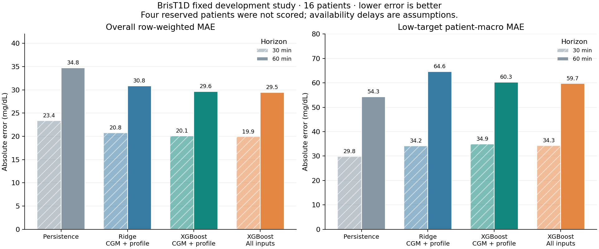

# BrisT1D fixed CPU input study v1

The full-input XGBoost method gives a small average improvement over its
CGM/profile counterpart. It still has substantial errors and worse low-target
MAE than persistence. This dataset/method round did not resolve the project's
adverse-event prediction problem. No dashboard model was replaced.

Sixteen development patients were evaluated once each in four patient-disjoint
folds. Four patients remain reserved. Availability assumptions, native cadence,
feature admission and targets were frozen before fitting in the
[data contract](BRIST1D_DATA_CONTRACT.md). All methods share evaluation rows.

## Overall measured errors

| Fixed method / inputs | MAE30 | MAE60 | RMSE30 | RMSE60 |
|---|---:|---:|---:|---:|
| persistence | 23.36 | 34.76 | 32.47 | 47.41 |
| Ridge / cgm only | 20.70 | 30.72 | 28.47 | 41.22 |
| Ridge / cgm profile | 20.76 | 30.85 | 28.51 | 41.29 |
| Ridge / cgm profile insulin | 20.86 | 31.16 | 28.57 | 41.52 |
| Ridge / cgm profile insulin carbs | 38.88 | 62.44 | 85.66 | 143.11 |
| Ridge / fused | 37.47 | 60.99 | 80.51 | 137.94 |
| Delta XGBoost / cgm only | 20.10 | 29.62 | 28.14 | 40.49 |
| Delta XGBoost / cgm profile | 20.07 | 29.63 | 28.07 | 40.42 |
| Delta XGBoost / cgm profile insulin | 19.97 | 29.59 | 27.93 | 40.44 |
| Delta XGBoost / cgm profile insulin carbs | 19.94 | 29.57 | 27.88 | 40.45 |
| Delta XGBoost / fused | 19.92 | 29.46 | 27.85 | 40.25 |

Units: mg/dL. These are row-pooled errors over 625,755 exact 30-minute
and 612,635 exact 60-minute targets. Each person contributes overlapping
windows; the number of independent patients is sixteen.

## Important error slices

| Method | Patient-macro low MAE30 / MAE60 | Patient-macro high MAE30 / MAE60 | Patient-macro P95 error30 / error60 |
|---|---:|---:|---:|
| persistence | 29.79 / 54.30 | 31.48 / 47.98 | 70.38 / 100.79 |
| ridge_cgm_profile | 34.16 / 64.63 | 28.00 / 44.61 | 61.17 / 86.55 |
| xgb_delta_cgm_profile | 34.90 / 60.32 | 28.60 / 46.31 | 61.11 / 85.85 |
| xgb_delta_fused | 34.25 / 59.71 | 28.37 / 46.19 | 60.65 / 85.43 |

Low and high slices use exact targets below 70 and above 180 mg/dL.
Each slice has observations from all sixteen development patients.
These are averages of patient metrics; P95 is the mean of sixteen
patient quantiles, not the pooled-row quantile.

## Does adding inputs help?

- 30 minutes: full inputs minus CGM/profile mean patient MAE -0.186 mg/dL; exploratory paired patient-bootstrap 95% interval [-0.251, -0.108].
- 60 minutes: full inputs minus CGM/profile mean patient MAE -0.229 mg/dL; exploratory paired patient-bootstrap 95% interval [-0.402, -0.066].

Negative favors full inputs. The typical-error gain is small. High/low-target
MAE difference intervals include zero at both horizons; severe-error gains
remain weak. The 60-minute P95 difference interval also includes zero.
There is no selection-adjusted final-test or clinical-validation claim.

Ridge plus all inputs is rejected as a useful replacement in this study:
its errors deteriorated sharply.
A saved-model diagnostic traced the worst 60-minute Ridge case (1019.8 mg/dL absolute error) to large linear
extrapolation: `insulin_age_minutes` alone contributed -819.1 mg/dL.
A single such case does not explain every error.
Source streams
have long outages; v1 includes unbounded recency features, and its failed
results are retained. A separately versioned experiment should bound recency
and mask stale measurements, rather than silently rewrite these scores.

## Interpretation and next work

This is a young Type 1 cohort with mixed five-/15-minute CGM cadence and
explicit input delays. Its absolute scores are not a controlled comparison
with the existing RBG or reconstructed CGMacros dashboard results.
Recorded meals/doses do not prove prospective entry/upload availability.
No false-alarm, event recall, treatment or probability claim is made.

Next test bounded/freshness-aware action features in a named new version
and causal patient adaptation using only already matured outcomes. Preserve
these results and the four reserved patients; do not run another broad sweep.

## Runtime and verification

CPU training/evaluation: 151.45 seconds, 1027.07 MiB sampled peak RSS, 8 threads. There were 80 fixed fits (two models, five arms, four folds, two horizons), not 80 tuned configurations.

14 BrisT1D synthetic tests passed. Real-source checks verified prefix
parity and exact issue+horizon labels for both native cadences.
All 80 saved fold models reproduced 8 checked held-out prediction probes each.
Held-out arrays, aggregate error arithmetic and exclusion of reserved
participants were verified for both horizons. Existing dashboard models
were unchanged. These are correctness checks, not clinical validation.
[Report-bound verification artifact](../reports/brist1d_study_v1_checks.json).

[Full aggregate JSON](../reports/brist1d_study_v1.json),
[preparation counts](../reports/brist1d_preparation.json), and
[CPU study runner](../scripts/run_brist1d_study.py).

Selected methods are shown below; the failed full-input Ridge results
remain in the complete table above.

